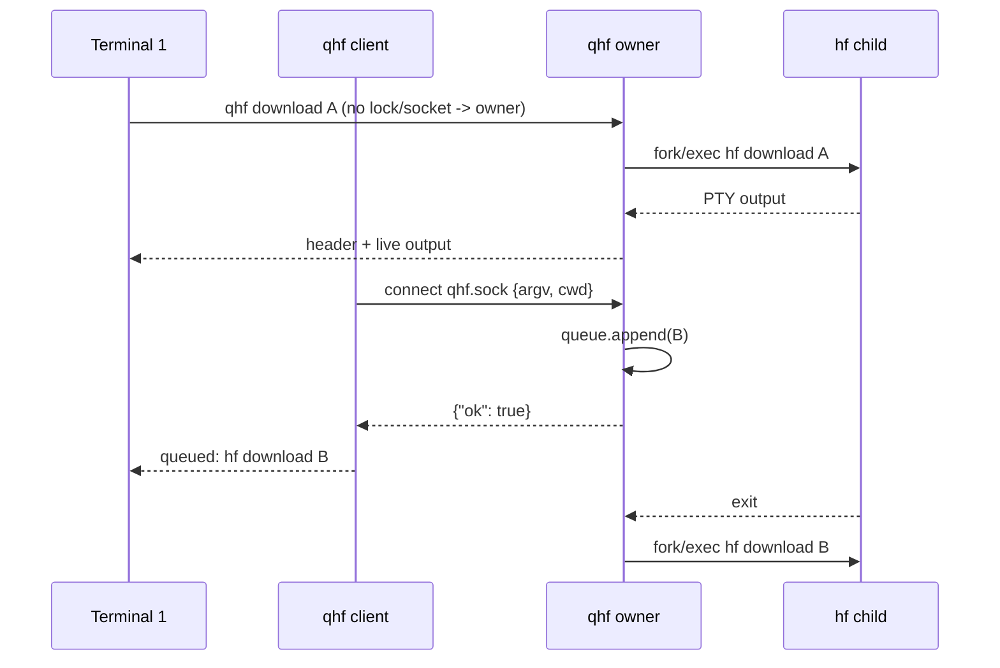

# QueueHuggingFace (`qhf`) design

Status: implemented, renamed 2026-11-07. One executable, Python stdlib only.
The project was called `hfq` until the rename; socket, lock, runtime directory
and environment variables are now `qhf`/`QHF_`.

## Process model



There is exactly one owner per runtime directory. Ownership is decided by
`fcntl.flock(LOCK_EX | LOCK_NB)` on `qhf.lock`; the lock is held for the
owner's lifetime and released by process exit. Clients try the socket first;
if a socket exists but the owner is exiting, the owner answers
`{"ok": false, "retry": true}` and the client loops. When the lock is free it
becomes the next owner, enqueueing its own argv before listening.

The socket is `SOCK_STREAM` at `qhf.sock`, directory `0700`, socket `0600`.
The listener thread accepts connections serially; each request is one JSON
line, max 64 KiB, with a 5 s read timeout.

Request:

```json
{"argv": ["download", "repo", "--local-dir", "models/x"], "cwd": "/abs/dir"}
```

Reply:

```json
{"ok": true, "pending": 2}
{"ok": false, "retry": true}
{"ok": false, "error": "argv must be a non-empty list of strings"}
```

`pending` counts items in the queue after the append (the active item is not
included). `cwd` must be an existing absolute directory; it becomes the
child's working directory. The owner's own argv is enqueued with its cwd.

## Queue

The queue is an in-memory `list[Item]` plus the current item. The main thread
pops items; the listener thread appends under `q_lock` and writes one byte to
a wake pipe. The main loop multiplexes the wake pipe and the active child's
output fd with `selectors`.

When the queue is empty the owner sets `closing` under the lock and exits.
Late clients get `retry`, then either connect to a new owner or become one
themselves once the lock drops. Pending work is not persisted.

## Child execution

TTY owner:

- `pty.fork()`; the child is a session leader with a controlling terminal,
  so `hf` renders progress bars as it would in a normal terminal.
- The child gets `cwd` via `os.chdir` before `execvpe("hf", ...)`.
- `TIOCSWINSZ` is set to the terminal width and the output-region height.
- The parent reads the master fd non-blocking and forwards bytes to stdout.
- EOF (or EIO) means the child closed the slave; `waitpid` reaps it.

Non-TTY owner:

- `subprocess.Popen` with `stdin=DEVNULL`, `stdout=PIPE`, `stderr=STDOUT`,
  `start_new_session=True`, so `hf` disables interactive progress rendering.
- The pipe is read non-blocking and forwarded verbatim.

Exit status: `0` is silent; anything else emits
`[qhf] hf exited with status N` (or `terminated by signal N`) into the output
area and the queue continues.

## Display

The TTY layout reserves rows `1..header_h`:

```text
QueueHuggingFace     row 1
Downloads                     row 2
> active command              row 3
  queued command              ...
  ... N more                  last list row
                              blank gap row = header_h
hf output starts at header_h+1, in scroll region [header_h+1, rows]
```

`header_h = 2 + entries + 1` (title, label, list, gap), capped at
`rows - 6` entries; overflow becomes `... N more`. Each line is truncated to
`cols - 1` and cleared with `ESC[2K`.

Redraw rules:

- The terminal is cleared once at startup.
- First render / resize: reset margins, set `[height+1, rows]`, draw.
- Header grows by `k`: set the old output region, move to its top, `ESC[kL`
  (insert lines, shifting the stream down), then set the new region and draw.
- Header shrinks by `k`: set the new region, move to its top, `ESC[kM`
  (delete lines, pulling the stream up), then draw.
- After drawing, place the cursor at `min(header_h + 1 + out_lines, rows)`.
  `out_lines` counts `\n` bytes in forwarded output (capped at `rows`);
  progress bars that rewrite one line with `\r` don't advance it.

Note: `CSI r` (set/reset scrolling margins) homes the cursor on VT100-style
terminals. Every path that sets or resets margins repositions the cursor
explicitly; the exit path moves to the stream row before printing the final
newline.

On exit (queue drained or signal), the owner resets margins, restores the
cursor to the stream row, prints one newline, unlinks the socket, and closes
the lock fd. The shell prompt lands after the last output, not over the
header.

Non-TTY mode prints the header block once and then uses plain status lines
(`running: hf ...`, `queued: hf ...`); no cursor addressing is emitted.

## Signals

| Signal | Effect |
|--------|--------|
| `SIGINT`, `SIGTERM`, `SIGHUP` | stop the loop, SIGINT the active child's process group (then SIGKILL after 2 s), discard the queue, exit 130 |
| `SIGWINCH` | re-measure, resize the child PTY, clear, redraw header |
| `SIGPIPE` | default (ignored by Python); a write to a dead stdout raises `BrokenPipeError`, caught at the entry point |

Signal handlers only set events; a non-blocking self-pipe registered with
`signal.set_wakeup_fd` wakes the selector.

## Known limits

- Queue state dies with the owner; no resume, no persistence.
- Children inherit the owner's environment, not each client's.
- The display cursor bookkeeping counts newlines, not wrapped lines; a
  header redraw during a wrapped output line can place the cursor one row
  early. Progress bars are sized by `tqdm`, so this does not occur in normal
  `hf download` output.
- One client is read at a time; a connected-but-silent client can delay the
  next enqueue by up to 5 s.
