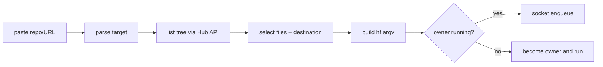

# Download configurator — implementation plan

Status: proposal, 2026-11-07. **Not implemented.** Current `qhf` is a
pass-through queue: `qhf download ...` ≡ a queued `hf download ...`.

## Goal

Typing `q` + a pasted Hub link should offer file selection before the command
joins the queue:

```console
$ qhf https://huggingface.co/Qwen/Qwen3-8B
QueueHuggingFace — Qwen/Qwen3-8B @ main — 16 files, 12.4 GB
  [x] 1  config.json                          1.1 KB
  [x] 2  generation_config.json               0.2 KB
  [x] 3  model-00001-of-00004.safetensors     4.9 GB
  ...
  [ ] 9  model-00004-of-00004.safetensors     1.8 GB

selection: all            [space] toggle  [1,3-5] select  [a]ll [n]one
[/] filter                [d]estination    [r]evision   [enter] queue  [q]uit
destination [./Qwen3-8B]:
revision    [main]:

queued: hf download Qwen/Qwen3-8B --local-dir /abs/Qwen3-8B \
        --revision main --include config.json --include ...
```

Hard rules:

- `qhf` stays **stdlib-only**. No `huggingface_hub` import in the executable.
- `qhf download ...` stays an exact pass-through with zero extra prompts.
- The configurator is **client-side**: it builds argv, then uses the existing
  owner/socket path. The queue remains a FIFO of argv.

## Architecture



The picker runs before `main`'s owner decision. If no owner exists, the
constructed command is enqueued only after the user confirms; the picker
process then becomes the owner and displays the download. If an owner exists,
the picker enqueues into it and exits. The owner protocol does not change for
v1.

## CLI surface

| Invocation | Behaviour |
|---|---|
| `qhf download ...` | exact pass-through (today's path) |
| `qhf pick <repo-or-url> [opts]` | explicit configurator |
| `qhf <http(s) URL>` | configurator (URL is unambiguous) |
| `qhf <owner/repo>` | configurator when the argument looks like a Hub repo ID |
| `qhf <other>` | pass-through to `hf` (current behaviour) |

Picker options:

- `--all` — skip selection; queue the whole repo.
- `--local-dir DIR` — set destination, skip the prompt (`~` expanded).
- `--revision REV` — set/override revision.
- `--dry-run` — print the constructed `hf` argv, do not enqueue.
- Remaining unknown options are appended to the built command after the
  `--include` flags (e.g. `--quiet`, `--token`).

Repo ID heuristic: `^[A-Za-z0-9_.-]+/[A-Za-z0-9_.-]+$`, no `.`/`..` segments,
and the first token is not an `hf` subcommand. URLs are parsed with
`urllib.parse` and must be `http(s)` on `huggingface.co` or `hf.co`.

Accepted URL forms:

- `https://huggingface.co/<owner>/<repo>`
- `https://huggingface.co/<owner>/<repo>/tree/<rev>[/<subdir>]`
- `https://huggingface.co/<owner>/<repo>/resolve/<rev>/<path>`
- `https://huggingface.co/datasets/<owner>/<repo>[/...]`
- `https://huggingface.co/spaces/<owner>/<repo>[/...]`
- bare `<owner>/<repo>` (models; datasets require the explicit prefix)

`/tree/<rev>/<subdir>` preselects that subtree; `/resolve/<rev>/<path>`
preselects that file.

## Repo listing

Use the public Hub tree endpoint from the stdlib:

```text
GET https://huggingface.co/api/{models|datasets|spaces}/{repo_id}/tree/{revision}
    ?recursive=true
```

The response is a JSON list of entries (verified 2026-11-07):

```json
{"type": "file", "oid": "ae8c...", "size": 391, "path": ".gitattributes"}
```

- Keep only `type == "file"` for selection; `type == "directory"` entries,
  when present, become bulk-toggle nodes.
- Omit `expand=true`; the compact response is enough and much smaller.
- Pagination: follow the `Link: <...cursor=...>; rel="next"` header until
  absent. Preserve `recursive=true` across pages. Cap at a sane number of
  pages (e.g. 500) and fail with "repo too large for the picker; use
  `--all`".
- HTTP errors map to actionable text:
  - 401/403 → "gated or private repo; run `hf auth login` or set `HF_TOKEN`"
  - 404 → "repo or revision not found"
  - 429 → "Hub rate limit; retry later"
- Auth: `HF_TOKEN` if set; otherwise read the CLI's cached token at
  `$HF_TOKEN_PATH`, defaulting to `$HF_HOME/token` →
  `~/.cache/huggingface/token` (verified: `huggingface_hub.constants`).
  Strip whitespace. Send `Authorization: Bearer ...` only to the fixed
  `huggingface.co` endpoint; never log the token.
- `QHF_API_BASE` overrides the base URL for tests/self-hosted mirrors
  (default `https://huggingface.co`). Tests point it at a local fixture.
- Optional pinning: fetch `GET /api/{models|datasets|spaces}/{repo_id}` for
  the resolved `sha`, then list and download at that SHA. This closes the
  branch-moved-between-listing-and-download race. Implement in phase 2 if
  the extra request is acceptable; otherwise pass the user's revision.

## Selection model

- Files are shown as a numbered list with `path` and human-readable size;
  directories are shown as headers or collapsible nodes.
- Default: everything selected, total size in the header. Enter with no
  changes queues the whole repo (same as `--all`, one confirmation).
- Line-mode commands (phase 3a, the contract):
  - `1,3-5` select; `-1,3` deselect; `a` all; `n` none; `space` toggle cursor;
  - `/regex` filter (case-insensitive, matches path);
  - `d` edit destination; `r` edit revision;
  - `enter` confirm; `q` cancel (exit 0, queue untouched).
- Curses tree (phase 3b, optional): arrow keys, space, `/`, `d`, `r`, `y`.
  Same state machine; the line UI remains the fallback for `TERM=dumb`.
- Destination default: `./<repo-name>` (or `<subdir-name>` for a subdir
  URL), expanded to an absolute path. `--local-dir` wins. Show the absolute
  path before confirmation; do not create it in the picker (the transfer
  does).
- Revision default: URL revision, else `main`. Show it; `r` edits it and
  re-lists.

## Command construction

```text
hf download <repo_id> --local-dir <abs>
   --revision <rev>
   --include <path> [--include <path> ...]
   [passthrough options]
```

- All files selected → omit every `--include` (whole-repo download).
- Subset → one `--include <exact path>` per selected file. Exact paths avoid
  glob surprises for `[`, `?`, `*` in filenames.
- Whole directory selected → collapse to `--include "<dir>/*"` when that is
  verified to cover the selection (Python's `fnmatch` treats `*` as matching
  `/`, but confirm against `hf download` before shipping).
- Argv-length guard: the Linux `ARG_MAX` is ~2 MiB, but keep the command
  under ~100 KiB for readability/`ps`. If the selection exceeds it, collapse
  directory prefixes; if still too long, refuse and suggest `--all`.
- Empty selection → "nothing selected", stay in the picker or exit 1; never
  enqueue an empty download.
- `--revision` is always emitted, including `main`, so the download matches
  what was listed.
- Order: repo, `--local-dir`, `--revision`, includes, passthrough. Typer
  accepts options in any order; verify once against the installed CLI.

## Queue integration and display

- Refactor `main()` into:
  - `resolve_argv(argv) -> (action, argv, cwd)` — pass-through, picker, or
    help;
  - `enqueue_or_own(argv, cwd)` — today's socket/lock logic.
- Picker process holds no lock while listing/selecting. Only after confirm
  does it compete for ownership. A cancelled picker never affects a running
  owner.
- Protocol v2 (optional, additive): the request may include
  `"label": "Qwen3-8B (42 files, 12.4 GB)"`. The owner renders the label in
  place of the long command; the argv that runs is unchanged. Older owners
  ignore the field; new clients omit it when no owner is running (they use
  their own label).
- The owner's environment is used for the transfer; the picker's token is
  only for listing. A gated repo therefore requires the owner to have
  `HF_TOKEN`/the cached token too. Document this in the picker error text.
- The queue display remains "first entry active, rest pending"; a long
  include list is truncated to the terminal width (existing behaviour).

## Phases and acceptance

### Phase 1 — parse, build, wire (no network)

- Add `parse_target()` and `build_download_argv()`; dispatch `pick` and
  bare-URL/repo forms; support `--all`, `--local-dir`, `--revision`,
  `--dry-run`; defer owner acquisition until after argv construction.
- Acceptance: `qhf pick owner/repo --all --local-dir X --dry-run` prints
  exactly `hf download owner/repo --local-dir /abs/X --revision main`;
  `qhf download ...` unchanged; existing tests pass; new table tests for the
  parser and builder.

### Phase 2 — listing

- `list_repo_files(kind, repo, rev)` over `urllib`; auth; pagination; errors;
  `QHF_API_BASE`.
- Acceptance: lists a real public repo (models and datasets); paginates a
  fixture with more entries than one page; handles 401/403/404/429 with the
  messages above; token file fallback works; no third-party imports.

### Phase 3 — picker

- 3a: line-mode selection + destination/revision prompts; include builder;
  cancel path; `--all` shortcut. 3b: curses skin (optional).
- Acceptance: select a subset from a fixture, confirm, and the stub `hf`
  receives exactly the expected argv; selecting all emits no `--include`;
  `q` enqueues nothing; a first-invocation picker becomes the owner and the
  download starts; `--local-dir` skips the destination prompt; relative
  default dest resolves against the client's cwd.

### Phase 4 — polish

- Directory-prefix collapsing and argv guard; protocol `label`; fish/bash
  completion for `qhf`; `--exclude` patterns.
- Acceptance: a directory selection produces one glob include; a >100 KiB
  selection fails with guidance; the header shows the label.

## Test strategy

- Pure functions first: URL/repo parser, selection parser, command builder —
  table-driven unit tests, no I/O.
- Listing: `http.server` fixture serving tree JSON and `Link` headers;
  assert request path/query, auth header, pagination, and error mapping.
- End-to-end: run the real `qhf` with `tests/stub/hf` on `PATH` and
  `QHF_API_BASE=http://127.0.0.1:<port>`; script the picker over stdin;
  assert the stub's logged argv and the queue's FIFO behaviour.
- No network in the suite. No change to the existing 5 tests.
- Manual: one real public repo in tmux at 100×28, one gated repo with
  `HF_TOKEN`, one `TERM=dumb` run.

## Risks / open questions

- **API drift.** The tree endpoint is public but unversioned. Keep `--all`
  (no listing) and `qhf download` as fallbacks.
- **Huge repos.** 100k+ files means large JSON, many pages, and a long
  selection UI. Paginate, cap, and prefer directory includes.
- **Auth duplication.** The picker reads the same token file as the CLI; it
  must never write it or print it. Gated downloads still depend on the
  owner's environment.
- **Branch race.** Listing at `main` then downloading at `main` can pull a
  newer commit. Prefer pinning to the resolved `sha` (phase 2 option).
- **Argv length / display.** Many includes are unwieldy. Collapse prefixes
  and add the display-only `label`.
- **UI scope.** Curses is optional; the line selector is the shippable
  contract and works over SSH/dumb terminals.
- **File-name globs.** Exact `--include` paths are the safe default; verify
  directory globs against the real CLI before collapsing.
- **Single-file growth.** The configurator adds parsing, HTTP, and UI. Keep
  the executable single-file for v1; split into a stdlib package only if it
  exceeds ~1200 lines or the selector grows a real screen model.

## Non-goals

Parallel downloads, resumable/persistent queues, a GUI/web UI, saved
per-repo preferences, token management, and replacing `hf`'s transfer engine.
